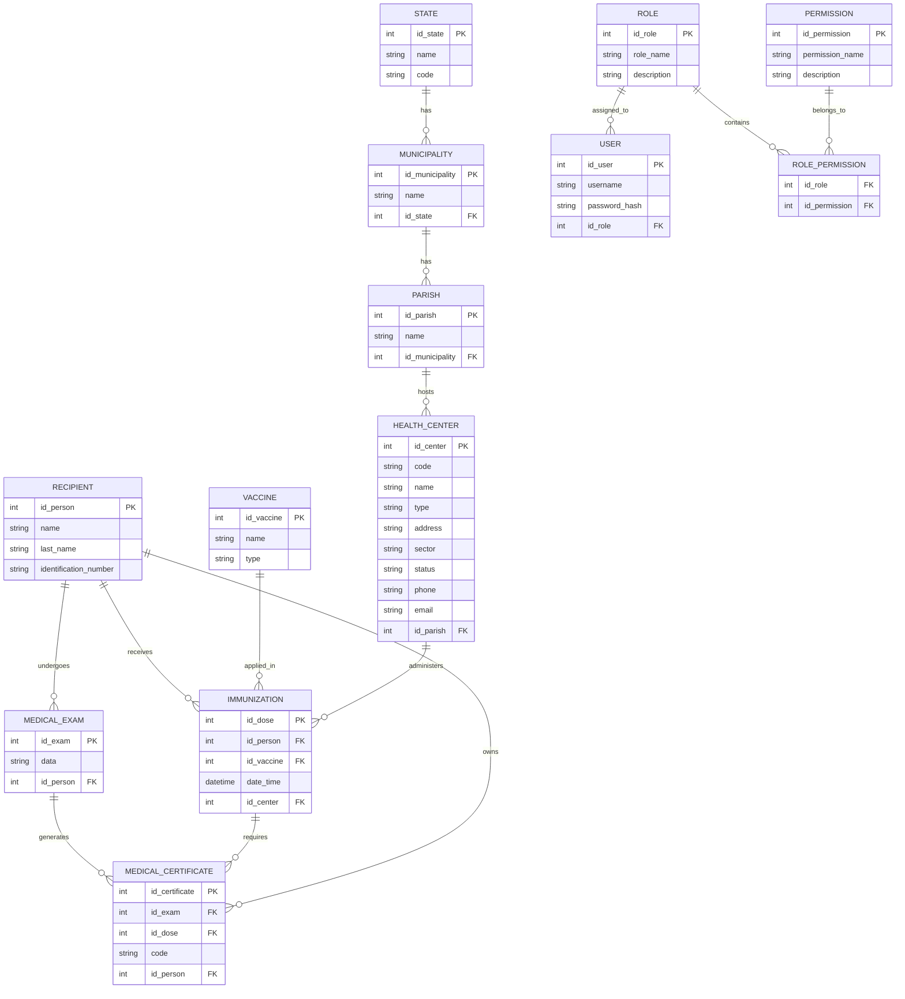

# Diagrama Entidad-Relación (ERD)

## Sistema Nacional de Inmunización y Control de Vacunación

A continuación se presenta el modelo entidad-relación que rige la persistencia de datos del sistema, garantizando la trazabilidad geográfica, la gestión de inventario y dosis, y la seguridad por roles (RBAC).

## Relaciones Principales

1. **Jerarquía Territorial:**
   - Un `STATE` posee múltiples `MUNICIPALITY`.
   - Un `MUNICIPALITY` posee múltiples `PARISH`.
   - Una `PARISH` alberga múltiples `HEALTH_CENTER`.

2. **Trazabilidad de Inmunización:**
   - Cada dosis registrada en `IMMUNIZATION` vincula obligatoriamente un paciente (`RECIPIENT`), una vacuna (`VACCINE`) y el centro de salud donde fue inoculada (`HEALTH_CENTER`).

3. **Control de Acceso (RBAC):**
   - Los usuarios (`USER`) están asociados a un rol (`ROLE`).
   - Cada rol (`ROLE`) tiene asignados uno o más permisos (`PERMISSION`) a través de la tabla relacional intermedia `ROLE_PERMISSION`.
