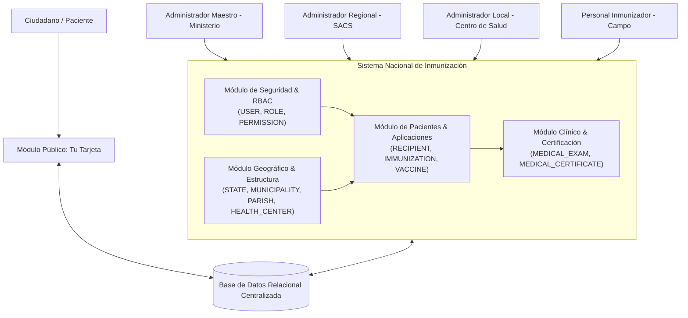
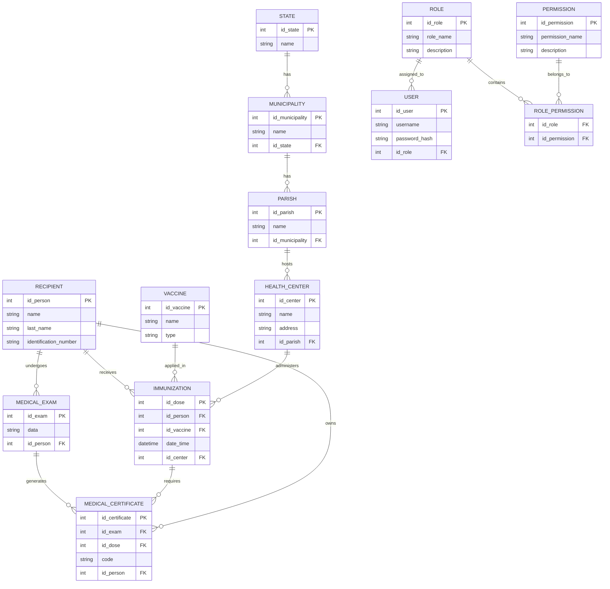
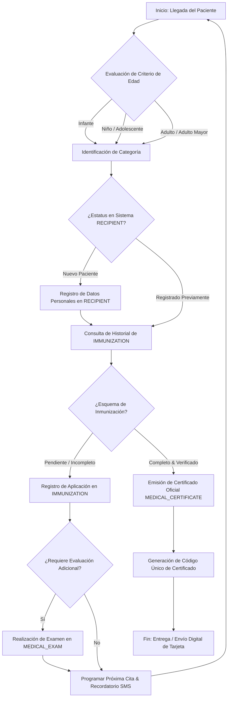
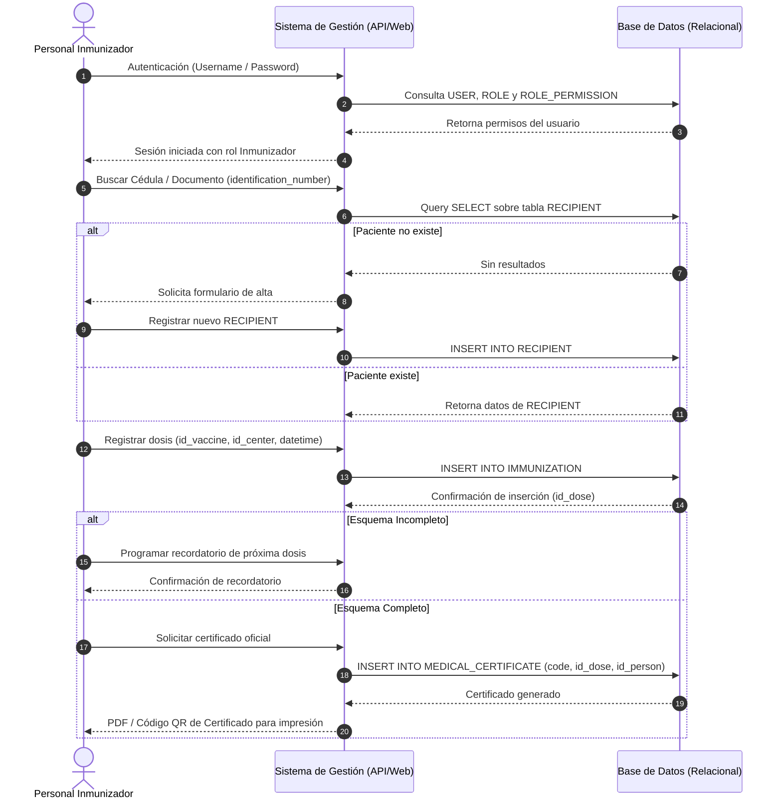

# Documento Técnico de Especificaciones del Sistema Nacional de Inmunización y Control de Vacunación

## 1. Descripción General del Sistema

El **Sistema Nacional de Inmunización y Control de Vacunación** es una plataforma centralizada de gestión de salud pública diseñada para el registro, trazabilidad, administración y validación del esquema de vacunación a nivel nacional.

Su arquitectura garantiza la integridad de los datos mediante una estructura territorial jerárquica (Estado, Municipio, Parroquia y Centro de Salud), un control de acceso basado en roles dinámico y granular (RBAC), y un módulo público independiente que permite al ciudadano consultar y certificar su estado de inmunización en tiempo real.

## 2. Estructura de Roles y Niveles de Permiso (RBAC)

El sistema define 4 niveles jerárquicos de administración interna, acompañados por un nivel de acceso público para el ciudadano:

- Administrador Maestro (El Ministerio)
- Administradores Regionales (SACS / Direcciones Regionales)
- Administradores Locales (Centro de Salud / Institución)
- Personal Inmunizador (Operadores en Campo)

### 1. Administrador Maestro (El Ministerio)

Nivel de autoridad máxima con acceso global sin restricciones.

- **Gestión de Cuentas y Roles:** Creación, modificación, suspensión y asignación de roles y permisos a nivel nacional.
- **Consolidación Nacional de Datos:** Acceso unificado a los registros de vacunación, exámenes e inventarios de todo el país.
- **Dashboard Centralizado:** Visualización de métricas nacionales en tiempo real, análisis de coberturas epidemiológicas y cuadros comparativos por estado y municipio.

### 2. Administradores Regionales (SACS / Direcciones Regionales)

Supervisan la gestión de salud pública dentro de una jurisdicción geográfica específica (`STATE`).

- **Gestión de Infraestructura Regional:** Registro, habilitación y actualización de centros de salud dentro de sus municipios y parroquias.
- **Gestión de Administradores Locales:** Alta y asignación de administradores para los centros habilitados en su región.
- **Supervisión y Análisis:** Monitoreo de coberturas y mapas interactivos de distribución a nivel regional.

### 3. Administradores Locales (Centro de Salud / Institución)

Supervisan las operaciones diarias de vacunación e inventario dentro de una institución médica específica (`HEALTH_CENTER`).

- **Gestión del Personal Inmunizador:** Alta, suspensión y control de operadores de campo asociados al centro.
- **Control de Inventario y Dosis:** Registro de lotes de vacunas, recepción y control de stock disponible.
- **Módulo de Validación y Emisión:** Verificación de certificados presentados físicamente y emisión del Certificado Oficial de Salud del centro.

### 4. Personal Inmunizador (Operadores en Campo)

Perfil optimizado para la atención directa y expedita en el punto de vacunación.

- **Registro de Pacientes (`RECIPIENT`):** Alta de nuevos ciudadanos en el sistema.
- **Consulta y Actualización:** Verificación del historial de dosis administradas y actualización de datos demográficos o clínicos.
- **Aplicación de Vacunas (`IMMUNIZATION`):** Registro de la dosis administrada, fecha/hora, lote y tipo de vacuna aplicada.
- **Emisión de Carnet Local:** Generación e impresión de la tarjeta de vacunación del paciente.

### 5. Módulo Ciudadano: "Tu Tarjeta"

Portal web público e independiente orientado a la consulta soberana del ciudadano.

- **Consulta Express:** Verificación del estado de inmunización mediante el número de documento de identidad (`identification_number`).
- **Emisión Digital:** Reenvío automático del Certificado de Salud digitalizado firmado electrónicamente al correo registrado.

## 3. Arquitectura General y Módulos del Sistema

## 4. Modelo de Datos Relacional (Entidad-Relación)

El modelo relacional garantiza la trazabilidad geográfica, la integridad clínica de las dosis aplicadas y el control de acceso estricto mediante RBAC:

## 5. Flujos de Trabajo e Interacción de Procesos

### 5.1. Diagrama de Flujo del Proceso de Inmunización y Certificación

Modela el flujo de decisión clínica para la atención de pacientes, evaluación del esquema de vacunación y generación final de certificados médicos sanitarios:

### 5.2. Diagrama de Secuencia: Operación de Registro de Aplicación (DFD de Secuencia)

Describe el intercambio de datos entre el **Personal Inmunizador**, la lógica de aplicación del sistema y las tablas de la base de datos relacional:

## 6. Especificaciones de Implementación y Seguridad

1. **Autenticación y Seguridad Granular:**

- Las contraseñas deben almacenarse encriptadas con algoritmo hash seguro (`password_hash` en la tabla `USER`).
- Toda petición a la API debe validar la matriz de permisos de la tabla intermedia `ROLE_PERMISSION`.

2. **Trazabilidad Territorial Obligatoria:**

- Cada registro de aplicación en `IMMUNIZATION` requiere la llave foránea obligatoria `id_center`, garantizando la auditoría exacta del centro de salud, parroquia, municipio y estado donde se aplicó el biológico.

3. **Verificación de Certificados:**

- El atributo `code` en la tabla `MEDICAL_CERTIFICATE` contendrá un hash alfanumérico único asociado a un código QR impreso en la tarjeta digital del ciudadano, permitiendo la validación pública e inalterable desde el módulo "Tu Tarjeta".
