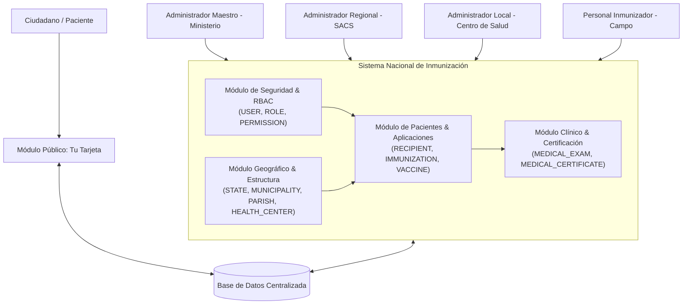
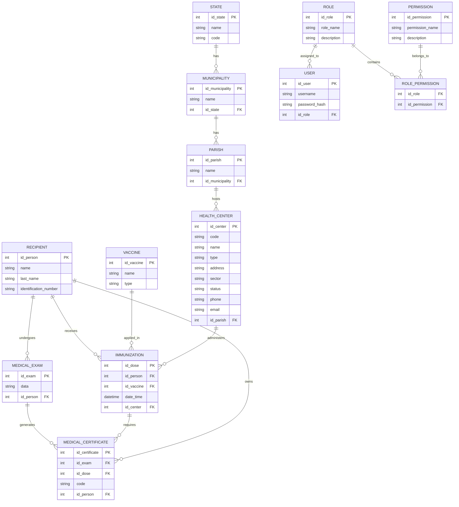
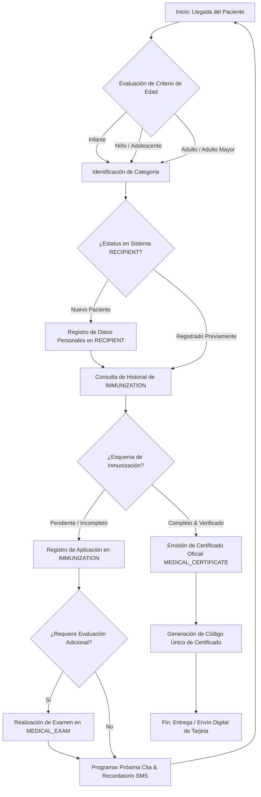
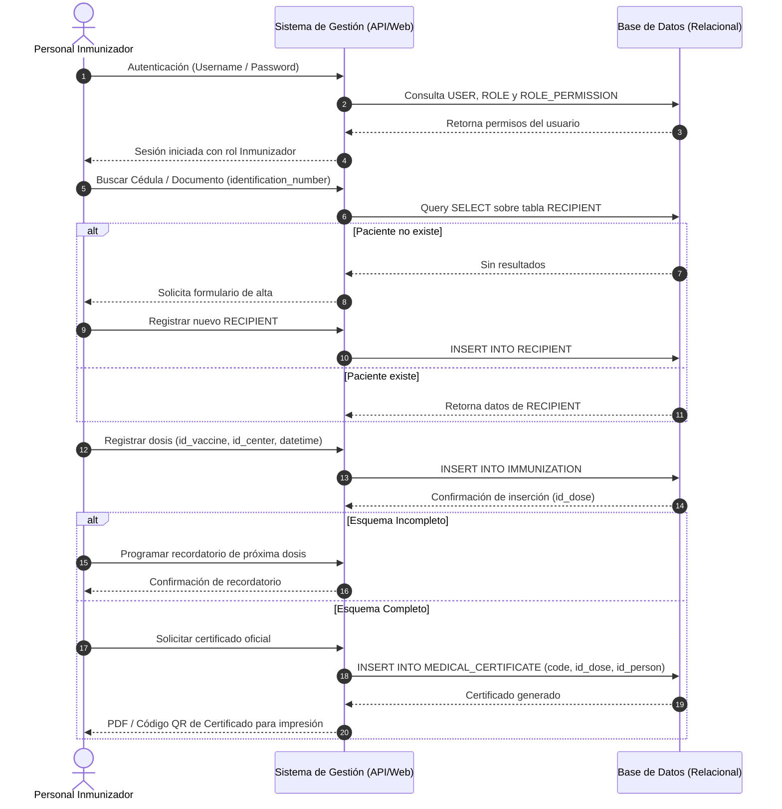

# Documento Técnico de Especificaciones del Sistema Nacional de Inmunización y Control de Vacunación

## 1. Descripción General del Sistema

El **Sistema Nacional de Inmunización y Control de Vacunación** es una plataforma centralizada de gestión de salud pública diseñada para el registro, trazabilidad, administración y validación del esquema de vacunación a nivel nacional.

Su arquitectura garantiza la integridad de los datos mediante una estructura territorial jerárquica (Estado, Municipio, Parroquia y Centro de Salud), un control de acceso basado en roles dinámico y granular (RBAC), y un módulo público independiente que permite al ciudadano consultar y certificar su estado de inmunización en tiempo real.

## 2. Estructura de Roles y Niveles de Permiso (RBAC)

El sistema define 4 niveles jerárquicos de administración interna, acompañados por un nivel de acceso público para el ciudadano:

- Administrador Maestro (El Ministerio)
- Administradores Regionales (SACS / Direcciones Regionales)
- Administradores Locales (Centro de Salud / Institución)
- Personal Inmunizador (Operadores en Campo)

### 1. Administrador Maestro (El Ministerio)

Nivel de autoridad máxima con acceso global sin restricciones.

- **Gestión de Cuentas y Roles:** Creación, modificación, suspensión y asignación de roles y permisos a nivel nacional.
- **Consolidación Nacional de Datos:** Acceso unificado a los registros de vacunación, exámenes e inventarios de todo el país.
- **Dashboard Centralizado:** Visualización de métricas nacionales en tiempo real, análisis de coberturas epidemiológicas y cuadros comparativos por estado y municipio.

### 2. Administradores Regionales (SACS / Direcciones Regionales)

Supervisan la gestión de salud pública dentro de una jurisdicción geográfica específica (`STATE`).

- **Gestión de Infraestructura Regional:** Registro, habilitación y actualización de centros de salud dentro de sus municipios y parroquias.
- **Gestión de Administradores Locales:** Alta y asignación de administradores para los centros habilitados en su región.
- **Supervisión y Análisis:** Monitoreo de coberturas y mapas interactivos de distribución a nivel regional.

### 3. Administradores Locales (Centro de Salud / Institución)

Supervisan las operaciones diarias de vacunación e inventario dentro de una institución médica específica (`HEALTH_CENTER`).

- **Gestión del Personal Inmunizador:** Alta, suspensión y control de operadores de campo asociados al centro.
- **Control de Inventario y Dosis:** Registro de lotes de vacunas, recepción y control de stock disponible.
- **Módulo de Validación y Emisión:** Verificación de certificados presentados físicamente y emisión del Certificado Oficial de Salud del centro.

### 4. Personal Inmunizador (Operadores en Campo)

Perfil optimizado para la atención directa y expedita en el punto de vacunación.

- **Registro de Pacientes (`RECIPIENT`):** Alta de nuevos ciudadanos en el sistema.
- **Consulta y Actualización:** Verificación del historial de dosis administradas y actualización de datos demográficos o clínicos.
- **Aplicación de Vacunas (`IMMUNIZATION`):** Registro de la dosis administrada, fecha/hora, lote y tipo de vacuna aplicada.
- **Emisión de Carnet Local:** Generación e impresión de la tarjeta de vacunación del paciente.

### 5. Módulo Ciudadano: "Tu Tarjeta"

Portal web público e independiente orientado a la consulta soberana del ciudadano.

- **Consulta Express:** Verificación del estado de inmunización mediante el número de documento de identidad (`identification_number`).
- **Emisión Digital:** Reenvío automático del Certificado de Salud digitalizado firmado electrónicamente al correo registrado.

### 2.1. Matriz Detallada de Permisos del Sistema (Catálogo RBAC)

> Para el desglose individual de cada permiso con sus descripciones oficiales, scripts de inserción (Seed SQL) y tipado en TypeScript, consulte el documento especializado [Catálogo y Matriz de Permisos (RBAC)](./permissions.md).

| Permiso (`permission_name`) | Administrador Maestro | Administrador Regional | Administrador Local | Personal Inmunizador |
| :--- | :---: | :---: | :---: | :---: |
| `users:create` / `users:update` | ✅ (Nacional) | ✅ (Regional) | ✅ (Local) | ❌ |
| `users:suspend` | ✅ | ✅ | ✅ | ❌ |
| `roles:manage` | ✅ | ❌ | ❌ | ❌ |
| `centers:create` / `centers:update` | ✅ (Nacional) | ✅ (En su estado) | ❌ | ❌ |
| `centers:read` | ✅ | ✅ | ✅ | ✅ |
| `vaccines:manage` | ✅ | ❌ | ❌ | ❌ |
| `inventory:manage` | ✅ | ❌ | ✅ (En su centro) | ❌ |
| `inventory:read` | ✅ | ✅ | ✅ | ✅ |
| `recipients:create` / `recipients:update` | ❌ | ❌ | ✅ | ✅ |
| `recipients:read` | ✅ | ✅ | ✅ | ✅ |
| `immunizations:create` | ❌ | ❌ | ❌ | ✅ |
| `immunizations:read` | ✅ | ✅ | ✅ | ✅ |
| `exams:create` / `exams:read` | ❌ | ❌ | ✅ | ✅ |
| `certificates:issue` | ❌ | ❌ | ✅ | ✅ (Carnet local) |
| `certificates:verify` | ✅ | ✅ | ✅ | ✅ |
| `reports:national` | ✅ | ❌ | ❌ | ❌ |
| `reports:regional` | ✅ | ✅ | ❌ | ❌ |
| `reports:local` | ✅ | ✅ | ✅ | ✅ |

## 3. Arquitectura General y Módulos del Sistema



## 4. Modelo de Datos Relacional (Entidad-Relación)

El modelo relacional garantiza la trazabilidad geográfica, la integridad clínica de las dosis aplicadas y el control de acceso estricto mediante RBAC:



### 4.1. Diccionario de Datos: Módulo Territorial y Centro de Salud

#### Tabla: `STATE` (Estado)
Representa la división política territorial de primer nivel (24 entidades federales de Venezuela).

| Campo | Tipo | Nulo | Restricciones | Descripción |
| :--- | :--- | :---: | :--- | :--- |
| `id_state` | INT (PK) | No | Auto-incremental | Identificador único del estado. |
| `name` | VARCHAR(100) | No | UNIQUE | Nombre oficial de la entidad federal (ej. *Miranda*, *Aragua*, *Zulia*). |
| `code` | VARCHAR(10) | No | UNIQUE | Código ISO / sigla ministerial (ej. `MIR`, `ARA`, `ZUL`, `DC`). |

#### Tabla: `MUNICIPALITY` (Municipio)
División territorial de segundo nivel adscrita a un estado específico.

| Campo | Tipo | Nulo | Restricciones | Descripción |
| :--- | :--- | :---: | :--- | :--- |
| `id_municipality` | INT (PK) | No | Auto-incremental | Identificador único del municipio. |
| `name` | VARCHAR(100) | No | | Nombre del municipio (ej. *Chacao*, *Sucre*, *Girardot*). |
| `id_state` | INT (FK) | No | REFERENCES `STATE(id_state)` | Estado al que pertenece. |

#### Tabla: `PARISH` (Parroquia)
División territorial de tercer nivel adscrita a un municipio. Nivel de demarcación local para los centros de salud.

| Campo | Tipo | Nulo | Restricciones | Descripción |
| :--- | :--- | :---: | :--- | :--- |
| `id_parish` | INT (PK) | No | Auto-incremental | Identificador único de la parroquia. |
| `name` | VARCHAR(100) | No | | Nombre de la parroquia (ej. *Petare*, *El Recreo*, *Choroni*). |
| `id_municipality` | INT (FK) | No | REFERENCES `MUNICIPALITY(id_municipality)` | Municipio al que pertenece. |

#### Tabla: `HEALTH_CENTER` (Centro de Salud)
Unidad médico-asistencial operativa donde se almacena biológico, se supervisa personal y se administran dosis a la población.

| Campo | Tipo | Nulo | Restricciones | Descripción |
| :--- | :--- | :---: | :--- | :--- |
| `id_center` | INT (PK) | No | Auto-incremental | Identificador único del centro de salud. |
| `code` | VARCHAR(50) | No | UNIQUE | Código oficial del centro (ej. `CS-MIR-001`, `AMB-ARA-042`). |
| `name` | VARCHAR(150) | No | | Denominación oficial del centro (ej. *Ambulatorio La Victoria*). |
| `type` | VARCHAR(50) | No | CHECK (`ambulatorio`, `hospital`, `cdi`, `clinica_popular`, `punto_vacunacion_movil`) | Tipología sanitaria del establecimiento. |
| `address` | TEXT | No | | Dirección física o vialidad principal. |
| `sector` | VARCHAR(100) | Sí | | Sector, caserío, barrio o comunidad específica. |
| `status` | VARCHAR(20) | No | DEFAULT `'activo'` CHECK (`activo`, `inactivo`, `mantenimiento`) | Estatus operativo del establecimiento. |
| `phone` | VARCHAR(20) | Sí | | Teléfono de contacto institucional. |
| `email` | VARCHAR(120) | Sí | | Correo electrónico de coordinación médica. |
| `id_parish` | INT (FK) | No | REFERENCES `PARISH(id_parish)` | Parroquia a la que está adscrito geográficamente. |

### 4.2. Especificación DDL Relacional (Centro de Salud y Territorio)

```sql
-- 1. Tabla de Estados
CREATE TABLE STATE (
    id_state SERIAL PRIMARY KEY,
    name VARCHAR(100) NOT NULL UNIQUE,
    code VARCHAR(10) NOT NULL UNIQUE
);

-- 2. Tabla de Municipios
CREATE TABLE MUNICIPALITY (
    id_municipality SERIAL PRIMARY KEY,
    name VARCHAR(100) NOT NULL,
    id_state INT NOT NULL REFERENCES STATE(id_state) ON DELETE RESTRICT,
    CONSTRAINT uq_municipality_state UNIQUE (name, id_state)
);

-- 3. Tabla de Parroquias
CREATE TABLE PARISH (
    id_parish SERIAL PRIMARY KEY,
    name VARCHAR(100) NOT NULL,
    id_municipality INT NOT NULL REFERENCES MUNICIPALITY(id_municipality) ON DELETE RESTRICT,
    CONSTRAINT uq_parish_municipality UNIQUE (name, id_municipality)
);

-- 4. Tabla de Centros de Salud
CREATE TABLE HEALTH_CENTER (
    id_center SERIAL PRIMARY KEY,
    code VARCHAR(50) NOT NULL UNIQUE,
    name VARCHAR(150) NOT NULL,
    type VARCHAR(50) NOT NULL DEFAULT 'ambulatorio' CHECK (type IN ('ambulatorio', 'hospital', 'cdi', 'clinica_popular', 'punto_vacunacion_movil')),
    address TEXT NOT NULL,
    sector VARCHAR(100),
    status VARCHAR(20) NOT NULL DEFAULT 'activo' CHECK (status IN ('activo', 'inactivo', 'mantenimiento')),
    phone VARCHAR(20),
    email VARCHAR(120),
    id_parish INT NOT NULL REFERENCES PARISH(id_parish) ON DELETE RESTRICT,
    created_at TIMESTAMP DEFAULT CURRENT_TIMESTAMP,
    updated_at TIMESTAMP DEFAULT CURRENT_TIMESTAMP
);

-- Índices de optimización geográfica y búsqueda
CREATE INDEX idx_municipality_state ON MUNICIPALITY(id_state);
CREATE INDEX idx_parish_municipality ON PARISH(id_municipality);
CREATE INDEX idx_center_parish ON HEALTH_CENTER(id_parish);
CREATE INDEX idx_center_name ON HEALTH_CENTER(name);
```

### 4.3. Implementación de Modelos en Backend (TypeScript / Mongoose)

Para la implementación en Node.js/Express con TypeScript y Mongoose (`app/backend`):

```typescript
// src/models/HealthCenter.ts
import { Schema, model, Document, Types } from 'mongoose';

export type HealthCenterType = 'ambulatorio' | 'hospital' | 'cdi' | 'clinica_popular' | 'punto_vacunacion_movil';
export type HealthCenterStatus = 'activo' | 'inactivo' | 'mantenimiento';

export interface IHealthCenter extends Document {
  name: string;
  code: string;
  type: HealthCenterType;
  address: string;
  sector?: string;
  parishId: Types.ObjectId;
  status: HealthCenterStatus;
  phone?: string;
  email?: string;
  createdAt?: Date;
  updatedAt?: Date;
}

const healthCenterSchema = new Schema<IHealthCenter>(
  {
    name: { type: String, required: true, trim: true, maxlength: 150 },
    code: { type: String, required: true, unique: true, uppercase: true, trim: true },
    type: {
      type: String,
      enum: ['ambulatorio', 'hospital', 'cdi', 'clinica_popular', 'punto_vacunacion_movil'],
      default: 'ambulatorio',
    },
    address: { type: String, required: true, trim: true },
    sector: { type: String, trim: true },
    parishId: { type: Schema.Types.ObjectId, ref: 'Parish', required: true, index: true },
    status: { type: String, enum: ['activo', 'inactivo', 'mantenimiento'], default: 'activo' },
    phone: { type: String, trim: true },
    email: { type: String, trim: true, lowercase: true },
  },
  { timestamps: true }
);

healthCenterSchema.index({ name: 1, parishId: 1 });

export default model<IHealthCenter>('HealthCenter', healthCenterSchema);
```

## 5. Flujos de Trabajo e Interacción de Procesos

### 5.1. Diagrama de Flujo del Proceso de Inmunización y Certificación

Modela el flujo de decisión clínica para la atención de pacientes, evaluación del esquema de vacunación y generación final de certificados médicos sanitarios:



### 5.2. Diagrama de Secuencia: Operación de Registro de Aplicación (DFD de Secuencia)

Describe el intercambio de datos entre el **Personal Inmunizador**, la lógica de aplicación del sistema y las tablas de la base de datos relacional:



## 6. Especificaciones de Implementación y Seguridad

1. **Autenticación y Seguridad Granular:**

- Las contraseñas deben almacenarse encriptadas con algoritmo hash seguro (`password_hash` en la tabla `USER`).
- Toda petición a la API debe validar la matriz de permisos de la tabla intermedia `ROLE_PERMISSION`.

2. **Trazabilidad Territorial Obligatoria:**

- Cada registro de aplicación en `IMMUNIZATION` requiere la llave foránea obligatoria `id_center`, garantizando la auditoría exacta del centro de salud, parroquia, municipio y estado donde se aplicó el biológico.

3. **Verificación de Certificados:**

- El atributo `code` en la tabla `MEDICAL_CERTIFICATE` contendrá un hash alfanumérico único asociado a un código QR impreso en la tarjeta digital del ciudadano, permitiendo la validación pública e inalterable desde el módulo "Tu Tarjeta".
