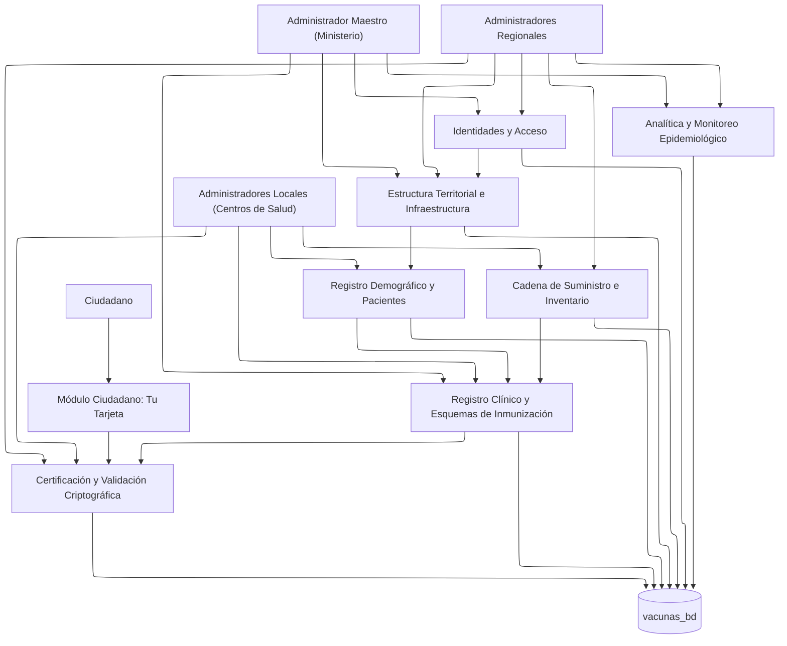
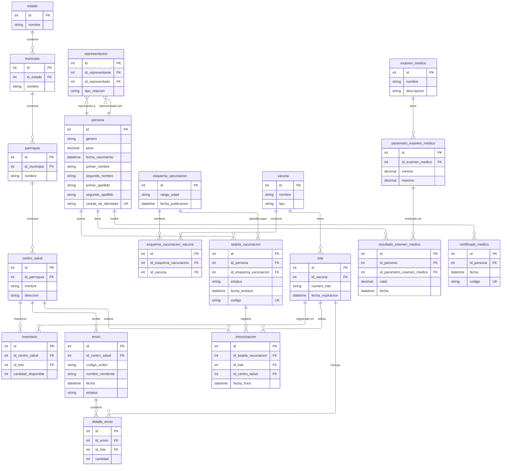
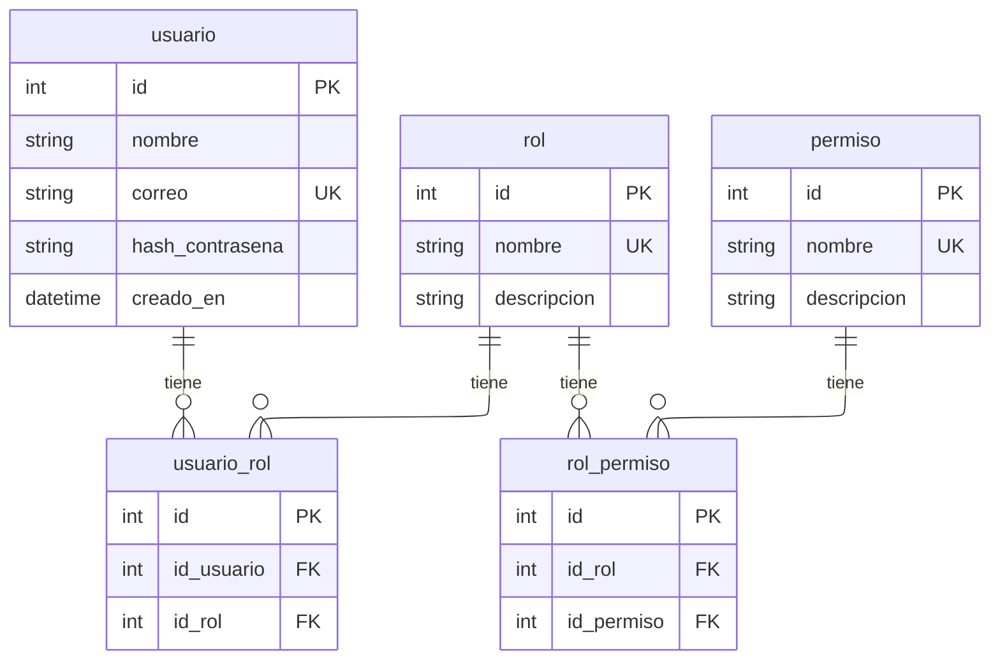
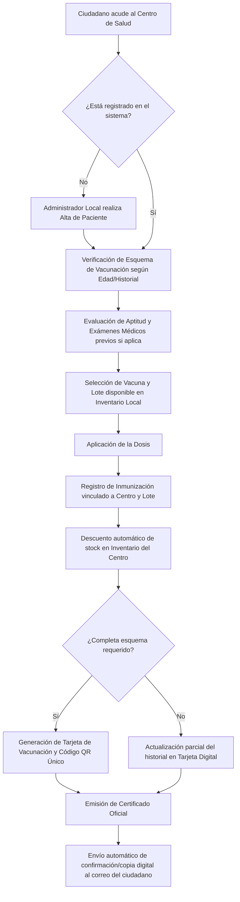

# Documento Técnico de Especificaciones del Sistema Nacional de Inmunización y Control de Vacunación (SINACIMN)

## TL;DR

El **Sistema Nacional de Inmunización y Control de Vacunación (SINACIMN)** es una plataforma centralizada de gestión de salud pública diseñada para el registro, trazabilidad, administración y validación del esquema de vacunación a nivel nacional.

Su arquitectura garantiza la integridad de los datos mediante una estructura territorial jerárquica (Estado, Municipio, Parroquia y Centro de Salud), un control de acceso basado en roles dinámico y granular, y un módulo público independiente que permite al ciudadano consultar y certificar su estado de inmunización en tiempo real.

## Requerimientos del Sistema

### Requerimientos Funcionales

- **Gestión de Identidad y Control de Acceso (RBAC):** Permitir la creación, modificación, suspensión y asignación granular de roles y permisos a usuarios administrativos según su jurisdicción territorial.
- **Administración de Estructura Territorial e Infraestructura:** Registrar, habilitar y actualizar centros de salud asociados jerárquicamente a su respectiva parroquia, municipio y estado.
- **Registro y Gestión de Ciudadanos:** Dar de alta nuevos pacientes en el sistema, actualizar sus datos demográficos o clínicos y gestionar vínculos de representación legal (menores de edad o dependientes).
- **Control de Inventario y Logística de Biológicos:** Registrar la recepción de envíos, gestionar lotes de vacunas con sus fechas de expiración y mantener el inventario actualizado por cada centro de salud.
- **Registro de Inmunización:** Documentar la aplicación de cada dosis asociando obligatoriamente al paciente, el esquema de vacunación, el lote utilizado, la fecha/hora y el centro de salud ejecutor.
- **Gestión de Exámenes y Certificación Médica:** Registrar parámetros y resultados de exámenes médicos clínicos para evaluar la aptitud del paciente y emitir certificados oficiales vinculados a su historial.
- **Emisión y Validación de Tarjetas de Vacunación:** Generar tarjetas digitales firmadas electrónicamente con un código QR único verificable.
- **Consulta Ciudadana Autónoma ("Tu Tarjeta"):** Proveer un portal público que permita a cualquier ciudadano verificar su estado de inmunización mediante su cédula de identidad y solicitar el reenvío de su tarjeta digital al correo electrónico registrado.
- **Analítica y Monitoreo Epidemiológico:** Consolidar datos a nivel regional y nacional para generar métricas en tiempo real, mapas interactivos de distribución y cuadros comparativos de cobertura.

### Requerimientos No Funcionales

- **Seguridad y Cifrado de Datos:** Almacenar todas las credenciales de acceso mediante algoritmos de hash criptográfico seguro y validar la matriz de permisos en cada petición realizada a la API.
- **Aislamiento de Bases de Datos:** Separar lógicamente la persistencia de los datos clínicos, personales y geográficos de la base de datos destinada al control de acceso, roles y autenticación de usuarios.
- **Integridad Referencial y Trazabilidad:** Garantizar que ningún evento de inmunización o movimiento de inventario pueda registrarse sin su correspondiente vinculación territorial y de lote.
- **Inalterabilidad y Verificabilidad Pública:** Asegurar que los códigos únicos de verificación asociados a tarjetas y certificados médicos no puedan ser falsificados y permitan una validación instantánea sin comprometer datos sensibles adicionales.
- **Disponibilidad y Rendimiento en Punto de Atención:** Mantener tiempos de respuesta óptimos en los módulos operativos locales y en el portal ciudadano para evitar cuellos de botella durante jornadas masivas de vacunación.
- **Escalabilidad Territorial:** Soportar el crecimiento progresivo de centros de salud, esquemas de vacunación y registros poblacionales a escala nacional sin degradación en la consolidación de reportes.

## Estructura de Roles y Niveles de Permiso

El sistema define tres niveles jerárquicos de administración interna, acompañados por un nivel de acceso público para el ciudadano:

- **Administrador Maestro:** Ministerio del Poder Popular para la Salud.
- **Administradores Regionales:** Direcciones Regionales de Salud.
- **Administradores Locales:** Centros de Salud e instituciones sanitarias.

### Administrador Maestro (El Ministerio)

Nivel de autoridad máxima con acceso global sin restricciones.

- **Gestión de Cuentas y Roles:** Creación, modificación, suspensión y asignación de roles y permisos a nivel nacional.
- **Consolidación Nacional de Datos:** Acceso unificado a los registros de vacunación y exámenes de todo el país.
- **Dashboard Centralizado:** Visualización de métricas nacionales en tiempo real, análisis de coberturas epidemiológicas y cuadros comparativos por estado y municipio.

### Administradores Regionales (Direcciones Regionales)

Supervisan la gestión de salud pública dentro de una jurisdicción geográfica específica (nivel estatal).

- **Gestión de Infraestructura Regional:** Registro, habilitación y actualización de centros de salud dentro de sus municipios y parroquias.
- **Gestión de Administradores Locales:** Alta y asignación de administradores para los centros habilitados en su región.
- **Supervisión y Análisis:** Monitoreo de coberturas y mapas interactivos de distribución a nivel regional.
- **Módulo de Validación y Emisión:** Verificación de certificados presentados físicamente, tarjeta de vacunación digital y emisión del Certificado Oficial de Salud del centro.

### Administradores Locales (Centro de Salud / Institución Sanitaria)

Perfil optimizado para la atención directa y expedita en el punto de vacunación.

- **Registro de Pacientes:** Alta de nuevos ciudadanos en el sistema.
- **Consulta y Actualización:** Verificación del historial de dosis administradas y actualización de datos demográficos o clínicos.
- **Aplicación de Vacunas:** Registro de la dosis administrada, fecha/hora, lote y tipo de vacuna aplicada.
- **Emisión de Tarjeta local:** Generación e impresión de la tarjeta de vacunación del paciente.

## Módulo Ciudadano: "Tu Tarjeta"

Portal web público e independiente orientado a la consulta soberana del ciudadano.

- **Consulta Express:** Verificación del estado de inmunización mediante el número de documento de identidad.
- **Emisión Digital:** Reenvío automático de la tarjeta de vacunación digitalizada y firmada electrónicamente al correo registrado.

## Arquitectura General y Módulos del Sistema

## Modelo de Datos Relacional

El sistema opera bajo una arquitectura de persistencia desacoplada mediante dos bases de datos paralelas: una dedicada al dominio sanitario, demográfico y territorial, y otra exclusiva para la gestión de identidades y control de acceso.

### Base de Datos Sanitaria, Personal y Geográfica

### Base de Datos de Usuarios, Roles y Permisos

## Flujos de Trabajo e Interacción de Procesos

### Proceso de Inmunización y Certificación

Modela el flujo de decisión clínica para la atención de pacientes, evaluación del esquema de vacunación y generación final de certificados médicos sanitarios:

## Especificaciones de Implementación y Seguridad

### Autenticación y Seguridad Granular

- Las contraseñas deben almacenarse encriptadas mediante un algoritmo hash seguro (atributo `hash_contrasena` en la entidad `usuario`).
- Toda petición recibida por la API debe validar previamente la matriz de autorización definida en la entidad intermedia `rol_permiso`.

### Trazabilidad Territorial Obligatoria

- Cada registro de aplicación en la entidad `inmunizacion` exige la llave foránea obligatoria `id_centro_salud`, garantizando la auditoría exacta del centro de salud, parroquia, municipio y estado donde se administró el biológico.

### Verificación de Certificados

- El atributo `codigo` en las entidades `certificado_medico` y `tarjeta_vacunacion` almacenará un identificador alfanumérico único vinculado a un código QR impreso en el documento digital del ciudadano, permitiendo su validación pública e inalterable desde el módulo "Tu Tarjeta".
